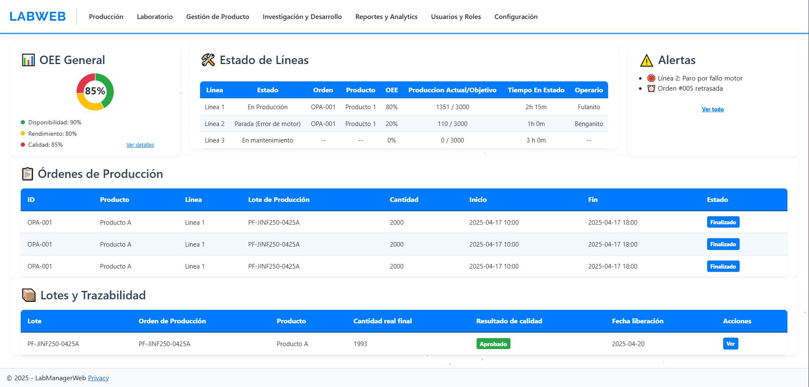

# LabProductionSystems

**LabProductionSystems** es una plataforma unificada para laboratorios farmacéuticos que integra Operaciones de Fabricación (MOM), LIMS, PDM e I+D.

---

##  Sobre el Autor

<table>
<tr>
<td align="center" width="140">
  
</td>
<td>
  <strong>Manuel Lázaro Velasco</strong><br>
  🧑‍💻 Desarrollador de Aplicaciones Multiplataforma<br>
  📍 Aranda de Duero, Burgos, España<br>
  📧 <a href="mailto:manulazaro2000@gmail.com">manulazaro2000@gmail.com</a><br>
  🔗 <a href="https://www.linkedin.com/in/manuel-l%C3%A1zaro-velasco-5501a6232/">LinkedIn</a>
</td>
</tr>
</table>

---

##  Descripción

**LabProductionSystems** es una plataforma web integrada y diseñada específicamente para laboratorios farmacéuticos y químicos involucrados en procesos de fabricación.

Reúne características esenciales de:

- **Gestión de Operaciones de Fabricación (MOM)**
- **Sistema de Gestión de Información de Laboratorio (LIMS)**
- **Gestión de Datos de Producto (PDM)**
- **Investigación y Desarrollo (I+D)**

en una solución única y centralizada.

### Características Principales:

- Monitorización en tiempo real de las líneas de producción y eficiencia de equipos (OEE)
- Control de calidad y gestión de pruebas de laboratorio vinculadas a lotes de producción
- Fórmulas, recetas y especificaciones de productos con control de versiones
- Transferencia de tecnología fluida desde I+D hasta la producción
- Completa trazabilidad, cumplimiento normativo y preparación para auditorías (GMP/GLP)

LabProductionSystems es ideal para organizaciones que buscan optimizar sus operaciones, garantizar la integridad de los datos y unificar los flujos de trabajo del laboratorio a la planta.

> Proyecto abierto a mejoras futuras y ampliación de funcionalidades.

---

##  Tecnologías Utilizadas

| Framework / Lenguaje | Base de Datos | Interfaz / Frontend |
|----------------------|---------------|---------------------|
| .NET / C#            | MySQL         | HTML5 / CSS / JS    |

Módulos y tecnologías adicionales:
- Autenticación y Autorización
- Planificación e Integración de Calendarios
- Control de Costes y Recursos
- Visualización de Datos (Gráficas, KPIs)
- Gestión de Equipos y Procesos

---

##  Interfaz Principal



---

##  Documentación

*(Próximamente)*

---

##  Cómo Ejecutar el Proyecto

```bash
# Clona el repositorio
git clone [https://github.com/ManuLazaro/LabProductionSystems.git](https://github.com/ManuLazaro/LabProductionSystems.git)

# Navega a la carpeta del proyecto
cd LabProductionSystems

# Abre y ejecuta la solución en Visual Studio o en tu entorno de desarrollo .NET preferido
